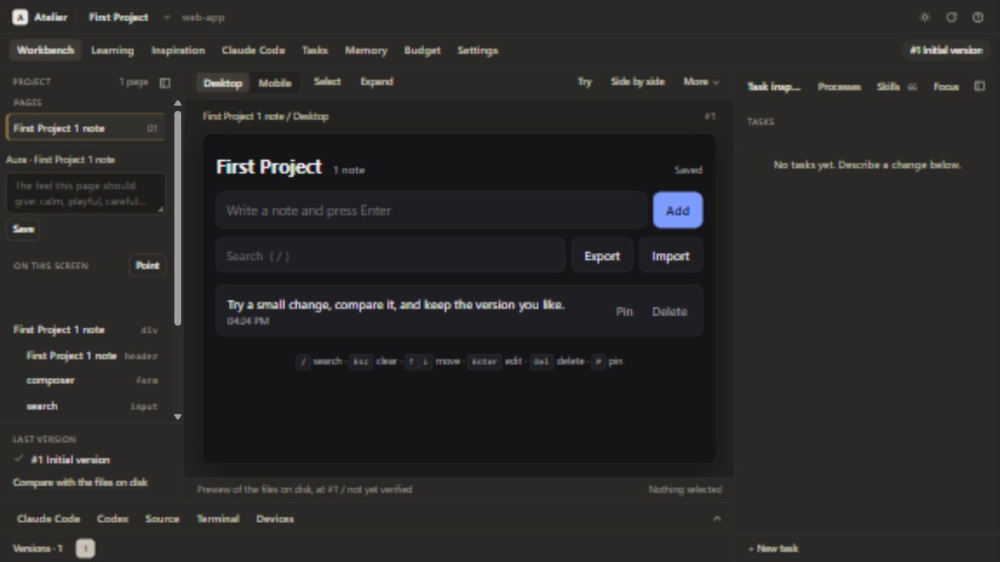

# vibeMomo

A local studio for vibe coding: you describe what you want, Claude Code builds it in a real
folder, and you try it, compare it with the last version, and keep the one you like.

**Early developer preview · Windows-first · MIT licensed**

[Quick start](#start) · [User guide](docs/GUIDE.md) · [Architecture](docs/ARCHITECTURE.md) ·
[Contributing](CONTRIBUTING.md)



It runs on your own computer as a small Node server with a browser window. Your projects are
ordinary folders with their own git history. vibemomo adds the things that usually get lost
between prompts: what you liked, what must not change, what to build from, and every version
you decided to keep.

> **About the name.** vibeMomo is the public name. Inside the code and on
> the screen the studio is still called **Atelier**: the package, the `atelier` command, the
> `ATELIER_*` settings and the `~/.atelier` data folder. This README uses the names you will
> actually see and type.

## What you do in it

1. Start a project from a template (a one-room game, a notes app, a sound sketch) or import a
   folder you already have.
2. Collect what you like on the **Inspiration** board, and write down what must stay the same
   as **Fixed rules**.
3. Write a task in plain words and hand it to Claude Code. The brief it receives carries your
   board, your rules and the references that match the request.
4. Try the result in the preview. Compare it with the last version, side by side if it is
   about feel.
5. Keep the version you prefer, with a note on why. Restore any earlier one when you change
   your mind.

`docs/GUIDE.md` walks through every screen; the same guide opens inside the studio from `?`.

## The design pieces

These five exist to keep a project looking like itself while Claude changes it.

- **Inspiration board.** One board per project. Drop or paste an image, or type a link, a hex
  colour or a few words. Give a card tags and a line on why you like it, pick colours out of
  an image, drag cards into order, filter by tag. Every task brief lists the board, tagged
  cards first.
- **Fixed rules.** One sentence per rule, with a kind (colour, type, layout, motion, tone,
  behaviour) and, if you like, a reason. A rule can lock a design token: a CSS custom property
  and the value it keeps. Every brief has a "Must stay the same" section, and Claude Code is
  told to ask you rather than break a rule. A rule is told, not enforced: nothing stops an
  edit from changing a locked value. The Visualizer is where you see it if one did.
- **Customization.** Settings › Appearance changes the studio's own look for you: accent,
  density, text size, corners and motion. An accent that would be hard to read on the canvas
  is refused, with the nearest shade that passes offered instead. A choice is greyed out when
  one of your fixed rules locks its token, and the rule is named beside it.
- **References.** What to build from: links (the page title is fetched for you), code
  snippets, prompts that worked, and notes, each with tags and a line saying what to use it
  for. A task gets only the references that match its request, at most eight.
- **Visualizer.** Reads the stylesheets your project's page really loads and draws them:
  colours as swatches with how often each is used, the type scale in the real fonts, spacing,
  corner radii, durations and easings. It marks values that drift from your board and shows
  whether each locked token is kept or broken. Every value links to its `file:line`. It
  changes no file; it can write a tidy-up task for you to read first.

Boards, rules and references live in the project's `.studio` folder. That folder is outside
the project's versions, so a Restore never changes them, and a clone of the project does not
carry them.

## What else is in the studio

- **Workbench**: the live preview, the version strip, compare and side by side, and a dock
  with a Companion chat (Claude Code with the studio's own tools), a page outline, a read-only
  source viewer, a real terminal, and a phone tab for Android projects driven through adb.
- **Tasks**: briefs handed to Claude Code, its notes, questions and results, and the version
  each task produced.
- **Learning**: lessons the Companion draws when you ask it to teach you something.
- **Memory**: preferences and decisions the briefs carry, which you can correct or retract.
- **Budget**: only if you add an API key. A few bounded utilities (summaries, tagging, a plain
  chat turn that cannot read or change files) may call the Claude API under a live ceiling.
  The ceiling starts at $40 until you change it in Budget. Building, debugging and review
  stay in Claude Code.
- **Codex tab** (optional): a second opinion from the Codex CLI on your own Codex login. Its
  own file edits are off unless you turn them on for that session.

`docs/ARCHITECTURE.md` describes every contract; `docs/DESIGN.md` describes the look.

## Requirements

- **Node.js 22 or later** and **git** on your PATH.
- **Claude Code**, installed and signed in with your own account, for AI-assisted building.
  The studio runs the `claude` command on your PATH. It can use that sign-in or an optional
  studio-specific token saved in Settings. What a session costs depends on your Claude plan.
  You can explore the interface, templates, and version tools without starting an AI session.
- **Windows 11** is where it was built and where the checks were run. The code has paths for
  macOS and Linux, but they have not been tried there.
- Optional: the Codex CLI for the Codex tab; an Anthropic API key for the Budget utilities;
  the Android SDK for the phone tab.

## Start

```sh
git clone https://github.com/rigpea/vibemomo.git
cd vibemomo
npm ci
npm start
```

Then open http://127.0.0.1:4747.

- `npm ci` installs the exact versions in the lockfile and also downloads Electron, which the optional desktop window uses
  (`npm run app`). The browser is enough.
- `npm run check` runs the syntax check, the template self-checks and the tests.
- New projects are created **beside** this folder, as its siblings. Set `ATELIER_PROJECTS_DIR`
  to choose another place. The studio's own data (project list, memory, settings) goes to
  `~/.atelier`; set `ATELIER_DATA_DIR` to move it. `.env.example` lists the settings.
- The Memory view starts empty. The studio writes no preference for you: add how you like to
  work with **Add memory**, and the briefs Claude Code reads carry what you added.

### Your first project

1. Choose **New project** and start with the notes-app template.
2. Open it in **Workbench** and press **Try** to use the preview.
3. The studio saves **Initial version #1** automatically. Open **Versions** to inspect it.
4. When ready to use Claude Code, create a task with a small change and review the result
   in the preview. Use **More → Keep version** to save changed files, or restore your earlier checkpoint.

### Configuration and troubleshooting

Copy [`.env.example`](.env.example) to `.env` to change the port or data locations.
Settings already exported in your shell take precedence. Restart the studio after editing it.
No API key is needed to start the studio; the optional API utilities are billed separately.

- **Port already in use:** set `ATELIER_PORT` in `.env`, then open that port in your browser.
- **Claude Code missing:** confirm `claude --version` works in the same terminal used to start
  the studio, then check the sign-in section in Settings.
- **Terminal unavailable:** `node-pty` needs its native component. If npm says its install
  scripts were blocked, review and allow that package's scripts, then reinstall. See the
  [contribution guide](CONTRIBUTING.md#local-setup) for details.
- **macOS or Linux:** these platforms are unverified. Reports with reproducible steps are welcome.
- **Desktop packaging:** the optional Electron build toolchain has known dependency audit
  findings. See [the current limitations](CONTRIBUTING.md#known-limitations) before building a binary.

## What is honest about it

- **Local.** The server listens on 127.0.0.1 only. There is no account, no hosted service and
  no telemetry. The network is used by what you start: Claude Code, a link you add (the
  studio fetches that page's title and preview image), and the API utilities if you gave a
  key.
- **File-based.** Everything is a file you can open: your project and its git history,
  `.studio/` records beside it, and `~/.atelier/`. Deleting the studio leaves your projects
  intact.
- **Nothing switches by itself.** A session stays on the backend and model you picked. The
  studio never moves work from your Claude Code login to a paid API key; the key is stripped
  from every Claude Code and terminal process it starts. The preview never reloads under
  you, and a project's own server starts only after you allow that exact command.
- **Status comes from evidence.** "Applied", "kept" and "done" are shown when a file, a
  commit or the product itself says so, not because a button was pressed.
- **It is not a sandbox.** Claude Code runs as you, with the permission mode you choose, and
  can do what you can do. Preview pages share an origin with the studio's own API, so open
  only projects you trust.
- **It is one person's tool, made public.** It has been used on a handful of projects on one
  Windows machine. There are no users to count and no benchmarks to quote. Rough edges are
  written down where they were found, in the docs and in code comments.

## What this copy leaves out

This repository is a clean copy of a private working repository. It starts with a new
history, and the working records were left behind: the decision log (`docs/DECISIONS.md`),
the plan (`docs/PLAN.md`), the build's running record (`docs/CONTINUATION.md`), the
verification records with their screenshots (`docs/evidence/`) and a concept image
(`docs/design/inspiration/`). Comments in the code and the documents under `docs/` still cite
them, most often as "decision row 69". Those citations point at files that are not here. The
comment or paragraph that cites one says what was chosen; the longer reasoning stayed in the
log.

`CLAUDE.md` was written for this copy and names only files that are here. `npm run evidence`
writes `docs/evidence/model-participation.json` from the Claude Code transcripts on your own
machine; the file names their folder, so `.gitignore` keeps it out of git.

## Licence

[MIT](LICENSE), copyright (c) 2026 rigpea. Dependencies retain their own licenses.
The source repository stays marked `private` in `package.json` to prevent accidental npm
publishing; this does not affect its GitHub visibility or MIT license.

## Contributing

See [CONTRIBUTING.md](CONTRIBUTING.md) for local setup, checks, and how to propose a change.
Report reproducible bugs through [GitHub Issues](https://github.com/rigpea/vibemomo/issues).
Please remove credentials, personal project contents, and local paths from reports.
